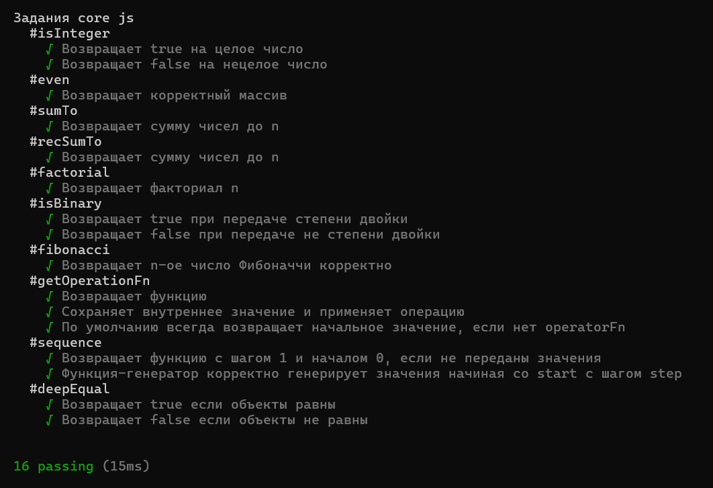

## Лабораторная работа №1

 **ФИО:** Давыдова Полина Алексеевна
 
 **Группа:** 6403-010302D

**Научный руководитель:** Мясников Владислав Валерьевич

**Тема диплома:** Исследование методов распознавания цифровых изображений, полученных средствами генеративного искусственного интеллекта

### Цитата (✿◡‿◡)
> Каждый день - это новое начало 

## Лабораторная работа №2
Разработан многостраничный сайт магазина свечей ручной работы "CandleCraft".
- **Тема:** Продажа самодельных свечей.
- **Технологии:** HTML5, CSS3.
- **Страницы:** Главная, Каталог, Доставка.
- **Реализованные элементы:** навигационное меню со ссылками, каталог товаров с изображениями, таблица с условиями доставки.

## Лабораторная работа №3
Изучение основ JavaScript. Реализован набор функций для работы с числами, массивами, объектами и замыканиями.
- **Технологии:** JavaScript (Node.js, Mocha).
- **Задачи:** Проверка на целое число, факториал, числа Фибоначчи, генераторы, глубокое сравнение объектов (deepEqual) и др.
- **Результат:** Все 16 тестов пройдены успешно.
